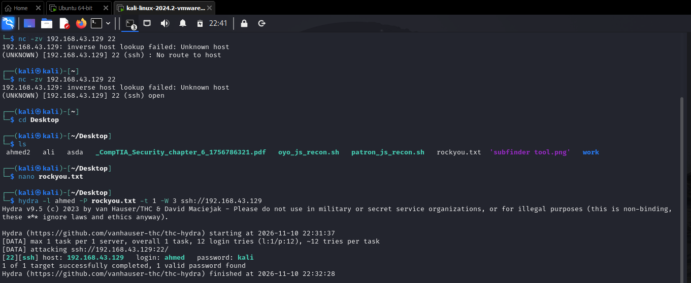
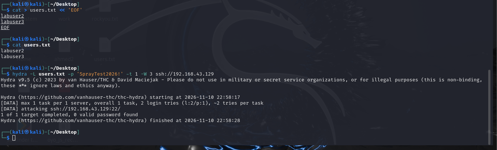
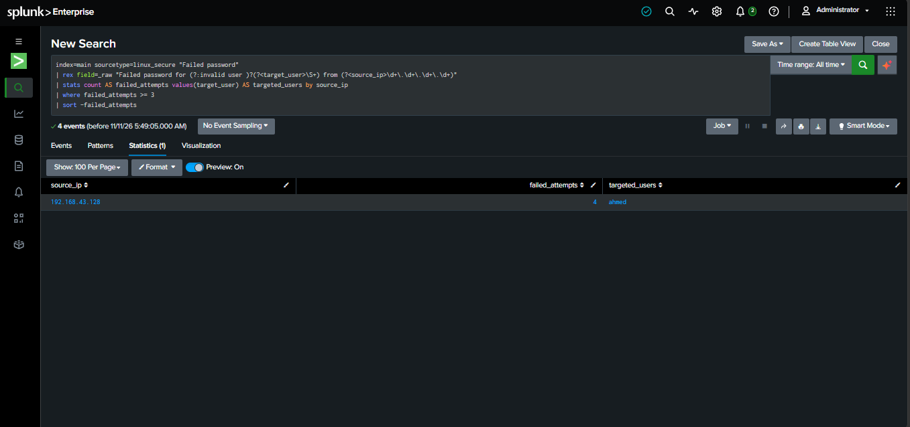
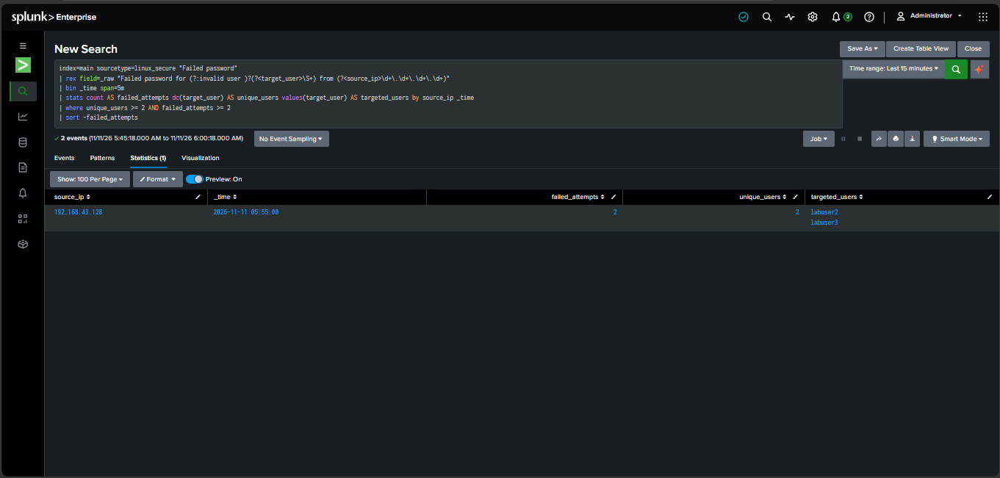
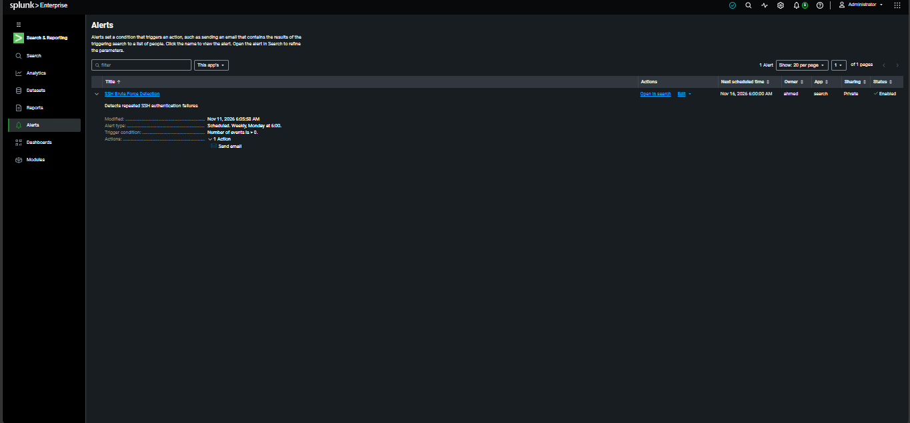

# SSH Brute Force & Password Spraying Detection Using Splunk


## 1. Project Overview

This project presents a practical SOC lab built to investigate suspicious SSH authentication activity using Splunk Enterprise.

Two attack scenarios were simulated in a controlled virtual environment: SSH Brute Force and Password Spraying. The resulting authentication logs were collected, forwarded, and analyzed to develop detection searches and automated security alerts.

## 2. Attack Techniques

| Brute Force | Password Spraying |
|---|---|
| Multiple passwords against one account | One password against multiple accounts |
| Attempts to compromise a specific user | Searches for accounts using weak passwords |
| Generates repeated failures for a targeted account | Distributes authentication attempts across accounts |

## 3. Lab Environment

| Machine | IP Address | Role |
|---|---|---|
| Kali Linux | `192.168.43.128` | Attacker |
| Ubuntu Linux | `192.168.43.129` | SSH Target |
| Windows | `192.168.43.1` | Splunk Enterprise |

**Tools and technologies:**
- Splunk Enterprise
- Splunk Universal Forwarder
- Kali Linux
- Ubuntu Linux
- Hydra
- OpenSSH
- Splunk SPL

## 4. Network Architecture

The lab uses Kali Linux to generate SSH authentication traffic against Ubuntu. The target machine forwards its authentication logs to Splunk Enterprise running on Windows.


**Log forwarding configuration:**

- Log source: `/var/log/auth.log`
- Splunk index: `main`
- Sourcetype: `linux_secure`
- Destination: `192.168.43.1:9997`
- Protocol: TCP

## 5. Attack Simulation

### 5.1 SSH Brute Force

Hydra was used to generate multiple password attempts against a single test account.

```bash
hydra -l labuser -P passwords.txt -t 1 -W 3 ssh://192.168.43.129
```



### 5.2 SSH Password Spraying

A single password was tested against multiple dedicated lab accounts.

```bash
hydra -L users.txt -p 'SprayTest2026!' -t 1 -W 3 ssh://192.168.43.129
```



All simulations were restricted to the lab environment.

## 6. Authentication Log Analysis

Ubuntu records SSH authentication activity in:

`/var/log/auth.log`

Important log messages include:

**Failed authentication:**

```text
Failed password for ahmed from 192.168.43.128 port 55548 ssh2
```

**Successful authentication:**

```text
Accepted password for ahmed from 192.168.43.128 port 37564 ssh2
```

These records provide information about the targeted account, source IP, and authentication outcome.

Linux SSH authentication logs do not use Windows Event IDs 4624 and 4625. Instead, detection relies on the authentication messages recorded by the SSH service.

## 7. Log Collection & Ingestion

Splunk Universal Forwarder was configured on Ubuntu to collect authentication logs and send them to the Windows Splunk Enterprise instance.

| Parameter | Configuration |
|---|---|
| Source | `/var/log/auth.log` |
| Index | `main` |
| Sourcetype | `linux_secure` |
| Receiving Port | `9997/TCP` |

## 8. Detection Engineering with SPL

### 8.1 SSH Brute Force Detection

This search identifies source IP addresses generating repeated failed SSH authentication events.

```spl
index=main sourcetype=linux_secure "Failed password"
| rex field=_raw "Failed password for (?:invalid user )?(?<target_user>\S+) from (?<source_ip>\d+\.\d+\.\d+\.\d+)"
| stats count AS failed_attempts values(target_user) AS targeted_users by source_ip
| where failed_attempts >= 3
| sort -failed_attempts
```

**Observed findings:**

- Source IP: `192.168.43.128`
- Targeted account: `ahmed`
- Returned failed events: `4`



### 8.2 SSH Password Spraying Detection

This search identifies a source IP associated with failed authentication attempts against multiple usernames.

```spl
index=main sourcetype=linux_secure "Failed password"
| rex "Failed password for (?:invalid user )?(?<user>\S+) from (?<src_ip>\d+\.\d+\.\d+\.\d+)"
| stats dc(user) AS unique_users values(user) AS users count AS failures by src_ip
| where unique_users >= 2
```



### 8.3 Failed Attempts Followed by Successful Authentication

This search correlates failed and successful authentication events for the same source IP and username.

```spl
index=main sourcetype=linux_secure ("Failed password" OR "Accepted password")
| rex field=_raw "(?:Failed|Accepted) password for (?:invalid user )?(?<user>\S+) from (?<src_ip>\d+\.\d+\.\d+\.\d+)"
| stats count(eval(searchmatch("Failed password"))) AS failures
        count(eval(searchmatch("Accepted password"))) AS successes
        by src_ip user
| where failures >= 3 AND successes >= 1
```

### 8.4 SSH Authentication Timeline

This search visualizes failed authentication activity over time.

```spl
index=main sourcetype=linux_secure "Failed password"
| timechart span=1m count
```

## 9. Splunk Alerting

A scheduled alert was configured for SSH Brute Force detection.

| Setting | Value |
|---|---|
| Alert Name | SSH Brute Force Detection |
| Execution | Scheduled |
| Frequency | Every 5 minutes |
| Trigger Condition | Number of Results > 0 |
| Severity | High |

The alert condition was successfully triggered during the lab.



## 10. Investigation Results

The lab demonstrated the following capabilities:

- Collecting Linux SSH authentication logs centrally.
- Identifying repeated failed authentication activity.
- Extracting source IP addresses and targeted usernames.
- Investigating suspicious authentication patterns.
- Developing SPL-based detection searches.
- Configuring and validating a scheduled Splunk alert.

The observed attacker address was `192.168.43.128`, matching the Kali Linux machine configured in the lab.

## 11. Skills Demonstrated

- SOC Monitoring & Investigation
- SIEM Log Collection
- Linux Authentication Analysis
- Splunk Enterprise
- Splunk Search Processing Language (SPL)
- SSH Attack Simulation
- Brute Force Detection
- Password Spraying Detection
- Security Alert Configuration

## 12. Disclaimer

This project was performed in a controlled virtual lab using dedicated test machines and accounts. It is intended for educational purposes and defensive security research only.
