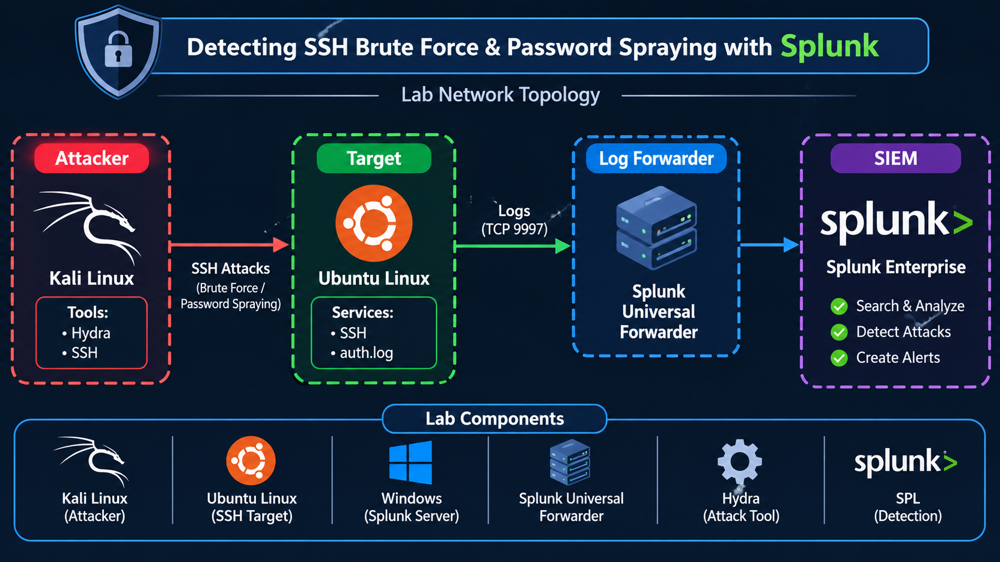

# SSH Brute Force & Password Spraying Detection Using Splunk

**بسم الله الرحمن الرحيم**

## 1. Project Overview

Authentication attacks are among the common techniques used to gain unauthorized access to systems.

In this project, I built a small SOC monitoring environment to simulate SSH login attacks, collect authentication logs, and investigate suspicious activities using Splunk Enterprise.

The main focus is to understand how repeated login failures appear in Linux logs and how detection rules can help security analysts identify potentially compromised accounts.

## 2. Attack Techniques

This lab covers two authentication attack scenarios:

| Brute Force | Password Spraying |
|---|---|
| Multiple passwords against one account | One password against multiple accounts |
| Focuses on compromising a specific user | Looks for weak passwords across different users |
| Often generates repeated failures for one username | Distributes failures across several usernames |

## 3. Lab Environment

The environment contains three virtual machines connected through a virtual network.

| System | IP Address | Purpose |
|---|---|---|
| Kali Linux | `192.168.43.128` | Attack simulation |
| Ubuntu Linux | `192.168.43.129` | SSH server and log source |
| Windows | `192.168.43.1` | Splunk Enterprise |

**Technologies used:**
- Kali Linux
- Ubuntu Linux
- Windows
- Splunk Enterprise
- Splunk Universal Forwarder
- Hydra
- OpenSSH

## 4. Network Architecture

The attack traffic originates from Kali Linux and targets the SSH service running on Ubuntu.

Authentication logs are collected on Ubuntu and forwarded to Splunk Enterprise for investigation.



**Log forwarding configuration:**
- Destination: `192.168.43.1`
- Port: `9997/TCP`
- Log file: `/var/log/auth.log`

## 5. Attack Simulation

### Scenario 1: SSH Brute Force

Hydra was used from Kali Linux to generate repeated SSH authentication attempts against a lab account on Ubuntu.

Example command:

```bash
hydra -l labuser -P passwords.txt -t 1 -W 3 ssh://192.168.43.129
```

The objective was to generate authentication failures and examine how they are recorded in the target system.

### Scenario 2: SSH Password Spraying

The second scenario targets multiple dedicated test accounts using the same password.

Example command:

```bash
hydra -L users.txt -p 'SprayTest2026!' -t 1 -W 3 ssh://192.168.43.129
```

This allows us to compare the log patterns generated by both attack techniques.

*All simulations were performed against systems and accounts dedicated to this lab.*

## 6. Understanding Linux Authentication Logs

Ubuntu stores SSH authentication activity in:

```text
/var/log/auth.log
```

Two important message patterns are:

**Failed login:**

```text
Failed password for ahmed from 192.168.43.128 port 55548 ssh2
```

**Successful login:**

```text
Accepted password for ahmed from 192.168.43.128 port 37564 ssh2
```

These messages provide useful investigation fields:

- Username being accessed.
- Source IP address.
- Authentication result.
- SSH connection details.

Unlike Windows Security logs, Linux SSH authentication events are identified through log messages rather than Windows Event IDs such as 4624 and 4625.

## 7. Log Collection in Splunk

Splunk Universal Forwarder was installed on Ubuntu to send authentication events to the Windows Splunk Enterprise instance.

| Configuration | Value |
|---|---|
| Index | `main` |
| Sourcetype | `linux_secure` |
| Source | `/var/log/auth.log` |
| Forwarding Port | `9997` |

### Data Ingestion Evidence


## 8. Detection Engineering with SPL

The following searches were developed to investigate suspicious SSH authentication activity.

### Detection 1: Repeated SSH Authentication Failures

This search groups failed login events by source IP and identifies repeated attempts.

```spl
index=main sourcetype=linux_secure "Failed password"
| rex field=_raw "Failed password for (?:invalid user )?(?<target_user>\S+) from (?<source_ip>\d+\.\d+\.\d+\.\d+)"
| stats count AS failed_attempts values(target_user) AS targeted_users by source_ip
| where failed_attempts >= 3
| sort -failed_attempts
```

**Observed result:**

| Field | Value |
|---|---|
| Source IP | `192.168.43.128` |
| Targeted Account | `ahmed` |
| Failed Events Returned | `4` |

The search identified repeated failed authentication activity originating from the Kali machine.

### Brute Force Detection Evidence


### Detection 2: Multiple Accounts Targeted by One Source

Password Spraying can be investigated by counting the distinct usernames associated with each source IP.

```spl
index=main sourcetype=linux_secure "Failed password"
| rex "Failed password for (?:invalid user )?(?<user>\S+) from (?<src_ip>\d+\.\d+\.\d+\.\d+)"
| stats dc(user) AS unique_users values(user) AS users count AS failures by src_ip
| where unique_users >= 2
```

The search highlights source addresses associated with failed authentication attempts against multiple accounts.

### Password Spraying Evidence


### Detection 3: Failed Attempts Followed by a Successful Login

A successful authentication after several failures deserves further investigation.

```spl
index=main sourcetype=linux_secure ("Failed password" OR "Accepted password")
| rex field=_raw "(?:Failed|Accepted) password for (?:invalid user )?(?<user>\S+) from (?<src_ip>\d+\.\d+\.\d+\.\d+)"
| stats count(eval(searchmatch("Failed password"))) AS failures
        count(eval(searchmatch("Accepted password"))) AS successes
        by src_ip user
| where failures >= 3 AND successes >= 1
```

This correlation helps identify accounts that experienced repeated failures and subsequently authenticated successfully.

### Detection 4: SSH Attack Activity Over Time

A time-based visualization helps analysts understand when authentication failures occurred.

```spl
index=main sourcetype=linux_secure "Failed password"
| timechart span=1m count
```

A concentration of failed authentication events within a short period may indicate suspicious activity.

## 9. Automated Alerting

A scheduled alert was configured in Splunk to monitor the Brute Force detection search.

**Alert configuration:**

- Name: `SSH Brute Force Detection`
- Execution: Scheduled
- Schedule: Every 5 minutes
- Trigger condition: Number of Results greater than 0
- Severity: High

The alert notification confirmed that the configured detection condition was triggered.

### Alert Notification Evidence


## 10. Investigation Findings

During the lab, Splunk provided visibility into SSH authentication activity, including:

- Repeated failed authentication messages.
- Source IP identification.
- Targeted account identification.
- Successful SSH authentication events.
- Detection searches and scheduled alert notifications.

The observed source address `192.168.43.128` matched the Kali Linux machine in the lab network.

## 11. Skills Demonstrated

- Linux authentication log analysis.
- SIEM log ingestion and monitoring.
- Splunk Search Processing Language (SPL).
- SSH attack simulation with Hydra.
- Brute Force detection.
- Password Spraying detection logic.
- Correlation of failed and successful authentication.
- Scheduled alert configuration.

## 12. Disclaimer

This environment was created strictly for educational and defensive cybersecurity purposes. All attack simulations were restricted to the virtual machines and test accounts used in this lab.
