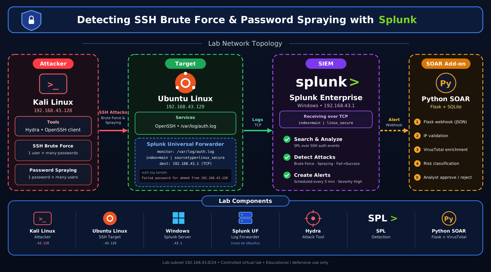
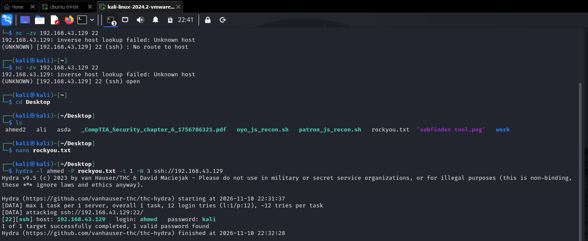
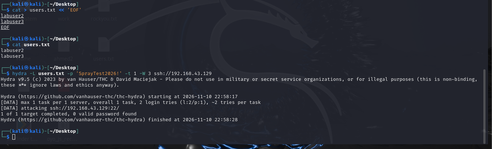
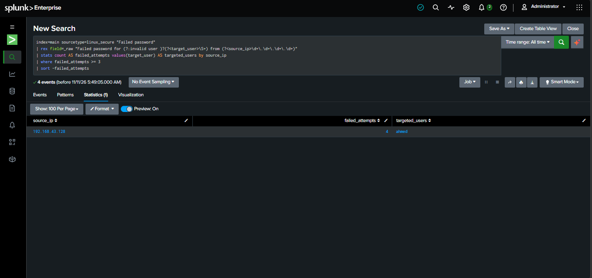
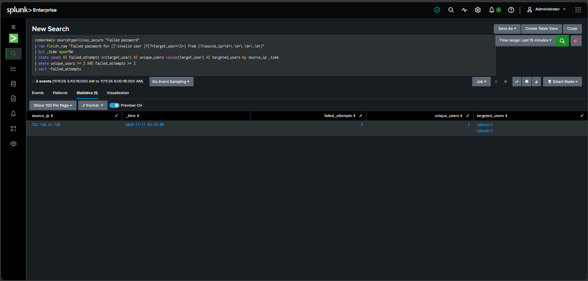
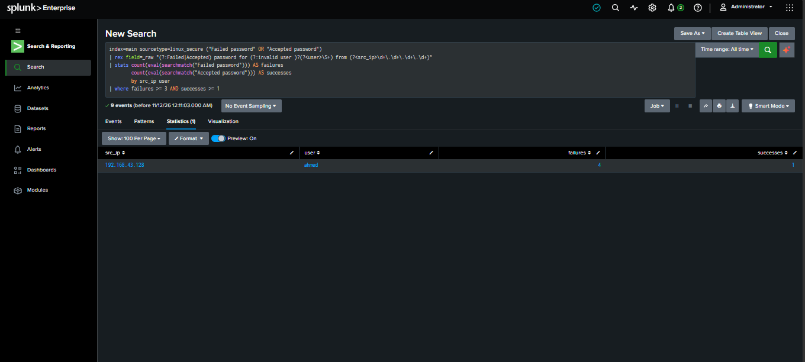
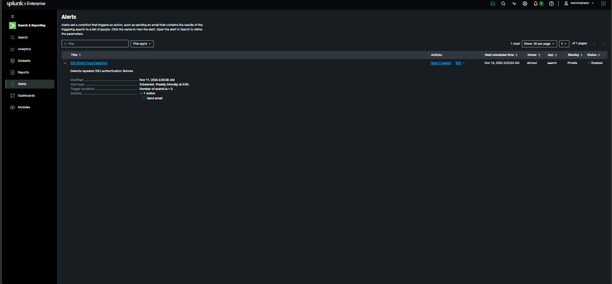
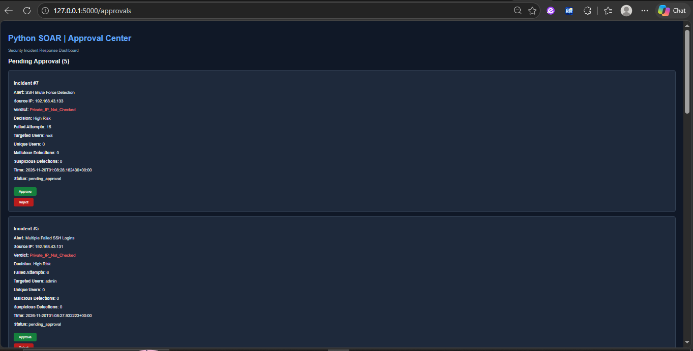
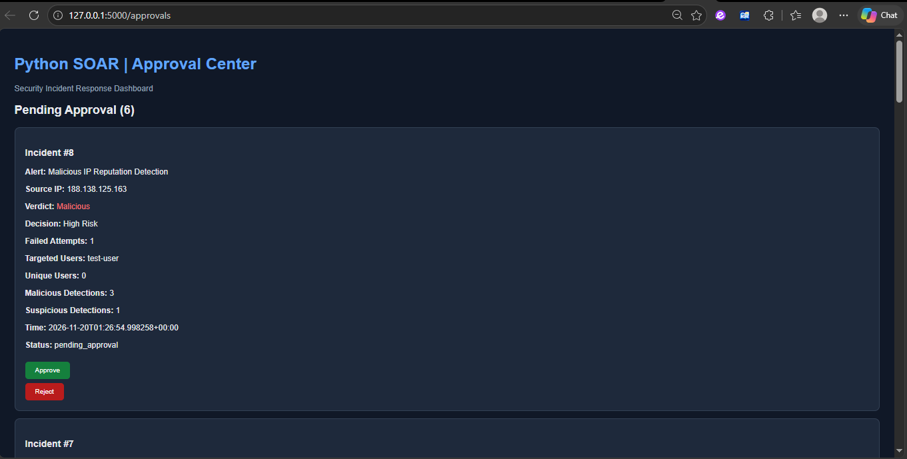
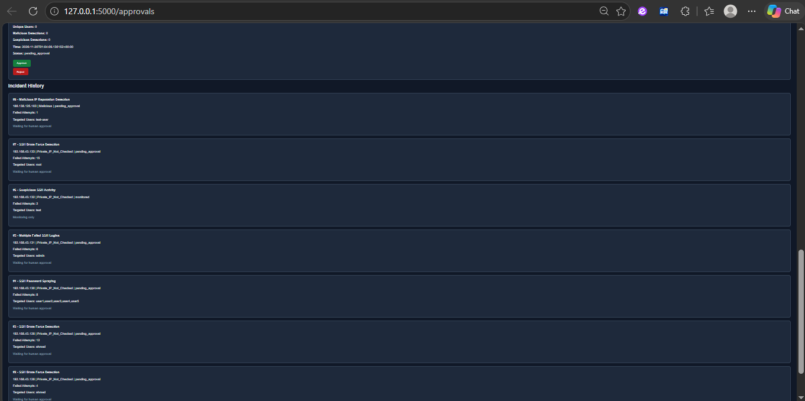

# SSH Brute Force & Password Spraying Detection Using Splunk


## 1. Project Overview

This project presents a practical SOC lab built to investigate suspicious SSH authentication activity using Splunk Enterprise.

Two attack scenarios were simulated in a controlled virtual environment: SSH Brute Force and Password Spraying. The resulting authentication logs were collected, forwarded, and analyzed to develop detection searches and automated security alerts.

## 2. Attack Techniques

| Brute Force | Password Spraying |
|---|---|
| Multiple passwords against one account | One password against multiple accounts |
| Attempts to compromise a specific user | Searches for accounts using weak passwords |
| Generates repeated failures for a targeted account | Distributes authentication attempts across accounts |

## 3. Lab Environment

| Machine | IP Address | Role |
|---|---|---|
| Kali Linux | `192.168.43.128` | Attacker |
| Ubuntu Linux | `192.168.43.129` | SSH Target |
| Windows | `192.168.43.1` | Splunk Enterprise |

**Tools and technologies:**
- Splunk Enterprise
- Splunk Universal Forwarder
- Kali Linux
- Ubuntu Linux
- Hydra
- OpenSSH
- Splunk SPL

## 4. Network Architecture

The lab uses Kali Linux to generate SSH authentication traffic against Ubuntu. The target machine forwards its authentication logs to Splunk Enterprise running on Windows.



**Log forwarding configuration:**

- Log source: `/var/log/auth.log`
- Splunk index: `main`
- Sourcetype: `linux_secure`
- Destination: `192.168.43.1:9997`
- Protocol: TCP

## 5. Attack Simulation

### 5.1 SSH Brute Force

Hydra was used to generate multiple password attempts against a single test account.

```bash
hydra -l labuser -P passwords.txt -t 1 -W 3 ssh://192.168.43.129
```



### 5.2 SSH Password Spraying

A single password was tested against multiple dedicated lab accounts.

```bash
hydra -L users.txt -p 'SprayTest2026!' -t 1 -W 3 ssh://192.168.43.129
```



All simulations were restricted to the lab environment.

## 6. Authentication Log Analysis

Ubuntu records SSH authentication activity in:

`/var/log/auth.log`

Important log messages include:

**Failed authentication:**

```text
Failed password for ahmed from 192.168.43.128 port 55548 ssh2
```

**Successful authentication:**

```text
Accepted password for ahmed from 192.168.43.128 port 37564 ssh2
```

These records provide information about the targeted account, source IP, and authentication outcome.

Linux SSH authentication logs do not use Windows Event IDs 4624 and 4625. Instead, detection relies on the authentication messages recorded by the SSH service.

## 7. Log Collection & Ingestion

Splunk Universal Forwarder was configured on Ubuntu to collect authentication logs and send them to the Windows Splunk Enterprise instance.

| Parameter | Configuration |
|---|---|
| Source | `/var/log/auth.log` |
| Index | `main` |
| Sourcetype | `linux_secure` |
| Receiving Port | `9997/TCP` |

## 8. Detection Engineering with SPL

### 8.1 SSH Brute Force Detection

This search identifies source IP addresses generating repeated failed SSH authentication events.

```spl
index=main sourcetype=linux_secure "Failed password"
| rex field=_raw "Failed password for (?:invalid user )?(?<target_user>\S+) from (?<source_ip>\d+\.\d+\.\d+\.\d+)"
| stats count AS failed_attempts values(target_user) AS targeted_users by source_ip
| where failed_attempts >= 3
| sort -failed_attempts
```

**Observed findings:**

- Source IP: `192.168.43.128`
- Targeted account: `ahmed`
- Returned failed events: `4`



### 8.2 SSH Password Spraying Detection

This search identifies a source IP associated with failed authentication attempts against multiple usernames.

```spl
index=main sourcetype=linux_secure "Failed password"
| rex "Failed password for (?:invalid user )?(?<user>\S+) from (?<src_ip>\d+\.\d+\.\d+\.\d+)"
| stats dc(user) AS unique_users values(user) AS users count AS failures by src_ip
| where unique_users >= 2
```



### 8.3 Failed Attempts Followed by Successful Authentication

This search correlates failed and successful authentication events for the same source IP and username.

```spl
index=main sourcetype=linux_secure ("Failed password" OR "Accepted password")
| rex field=_raw "(?:Failed|Accepted) password for (?:invalid user )?(?<user>\S+) from (?<src_ip>\d+\.\d+\.\d+\.\d+)"
| stats count(eval(searchmatch("Failed password"))) AS failures
        count(eval(searchmatch("Accepted password"))) AS successes
        by src_ip user
| where failures >= 3 AND successes >= 1
```


### 8.4 SSH Authentication Timeline

This search visualizes failed authentication activity over time.

```spl
index=main sourcetype=linux_secure "Failed password"
| timechart span=1m count
```

## 9. Splunk Alerting

A scheduled alert was configured for SSH Brute Force detection.

| Setting | Value |
|---|---|
| Alert Name | SSH Brute Force Detection |
| Execution | Scheduled |
| Frequency | Every 5 minutes |
| Trigger Condition | Number of Results > 0 |
| Severity | High |

The alert condition was successfully triggered during the lab.



## 10. Python-Based SOAR Integration

### 10.1 Motivation

During the implementation of the SOAR automation phase, deploying and configuring a dedicated SOAR platform introduced several challenges due to the available hardware resources, limited development time, and the complexity of the configuration and troubleshooting process.

To overcome these limitations and continue developing the automation workflow, I decided to build a lightweight Python-based SOAR solution using Flask and SQLite.

The solution uses a Flask Webhook to receive security events in a Splunk-compatible JSON format, integrates with VirusTotal for threat intelligence enrichment, and provides an Incident Approval Dashboard for analyst review.

### 10.2 SOAR Architecture

The implemented workflow consists of the following stages:

1. Security Event Ingestion through a Flask Webhook.
2. IP Address Validation and Classification.
3. Threat Intelligence Enrichment using VirusTotal.
4. Risk Classification and Incident Creation.
5. Human Approval through a web-based dashboard.

### 10.3 IP Address Validation

The first stage validates the source IP address and determines whether it is a private or public IP.

- **Private IP Address:** Identified as an internal address. VirusTotal enrichment is skipped because private lab addresses are not publicly routable.
- **Public IP Address:** Forwarded to VirusTotal for threat intelligence analysis.

Private IP addresses are not automatically considered safe. They can still trigger high-risk incidents based on the detected attack behavior.



### 10.4 VirusTotal Threat Intelligence Integration

For public IP addresses, the Python SOAR engine communicates with the VirusTotal API to retrieve IP reputation information.

The enrichment process extracts:

- Malicious detections.
- Suspicious detections.
- Harmless detections.
- Undetected results.

The returned intelligence is used as an additional input for incident risk classification.



### 10.5 Incident Classification

After event processing and enrichment, the system evaluates the available information and assigns a risk level.

| Risk Level | Description |
|---|---|
| High Risk | Multiple failed login attempts, password spraying indicators, or malicious IP reputation. |
| Medium Risk | Suspicious threat intelligence findings. |
| Low or Unknown Risk | No significant malicious indicators identified. |

High-risk and medium-risk incidents are submitted for human review, while low-risk events are retained for monitoring.


### 10.6 Incident Approval Dashboard

A Flask-based web dashboard was developed to provide centralized incident visibility and analyst interaction.

The dashboard displays:

- Incident ID and alert name.
- Source IP address.
- Number of failed attempts.
- Targeted usernames.
- VirusTotal verdict.
- Risk classification.
- Incident timestamp and status.

Analysts can review pending incidents and choose to approve or reject them.




### 10.7 Database and Incident Management

SQLite is used to persist incident records, including:

- Event details.
- Source IP addresses.
- Threat intelligence results.
- Risk decisions.
- Approval status.
- Analyst response actions.

This allows incidents to remain available in the dashboard after restarting the application.

 
### 10.8 Testing and Validation

The Python SOAR workflow was tested using representative security events based on the SSH Brute Force and Password Spraying scenarios documented in this project.

Testing covered:

1. Private IP validation and VirusTotal bypass.
2. Public IP threat intelligence enrichment.
3. High-risk incident classification.
4. Incident storage in SQLite.
5. Human approval and rejection.

 The webhook was tested by sending security event payloads directly to the Flask endpoint, validating event ingestion, IP enrichment, risk classification, and incident creation.

 
## 10. Investigation Results

The lab demonstrated the following capabilities:

- Collecting Linux SSH authentication logs centrally.
- Identifying repeated failed authentication activity.
- Extracting source IP addresses and targeted usernames.
- Investigating suspicious authentication patterns.
- Developing SPL-based detection searches.
- Configuring and validating a scheduled Splunk alert.

The observed attacker address was `192.168.43.128`, matching the Kali Linux machine configured in the lab.

## 11. Skills Demonstrated

- SOC Monitoring & Incident Investigation
- SIEM Log Collection and Analysis
- Linux Authentication Log Analysis
- Splunk Enterprise & Search Processing Language (SPL)
- SSH Attack Simulation and Detection
- SSH Brute Force Detection
- Password Spraying Detection
- Security Alert Configuration
- Python-Based SOAR Development
- Flask Webhook Integration
- VirusTotal API Integration & Threat Intelligence Enrichment
- IP Address Validation and Classification
- Incident Risk Classification
- Incident Management & Analyst Approval Workflow
- SQLite Database Management
- Security Automation and Workflow Development

## 12. Disclaimer

This project was performed in a controlled virtual lab using dedicated test machines and accounts. It is intended for educational purposes and defensive security research only.
